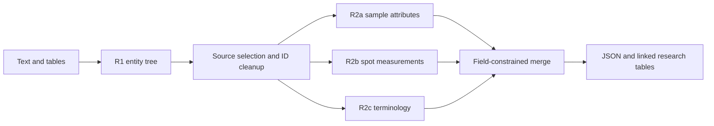
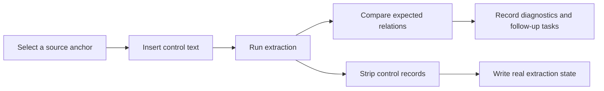

# FirstLight

**Exploring Scientific Information Extraction with Known-Answer Controls and Document-Graph Recovery.**

[English](README.md) · [简体中文](README.zh-CN.md)

This project extracts samples, analytical spots, ages, uncertainties and their relationships from geochronology papers, organizing text and table contents into records for subsequent scientific analysis.

It began as a modular extraction pipeline for a research database. Batch processing brought attention to a question that is harder to assess than JSON validity: **a language model can produce a well-formed, plausible result while omitting information that the source document requires it to retain.** Alongside staged extraction, the project explores known-answer controls and document-graph methods for recovering candidate relations.

## 1. Motivation: Valid Structure Does Not Establish Completeness

Scientific extraction requires both recognizing values and preserving their ownership and meaning. An age must remain associated with the correct sample, analytical method, uncertainty and geological interpretation. Multiple ages for one sample should not be reduced to a representative value without justification.

Early exploration involved triples, BERT-NER, GLiNER, word-frequency analysis and masked-language-model scoring. For geochronological identifiers, place names, ordinary entities and parsing artifacts could enter the candidate set. Subsequent work moved toward generative LLM extraction and staged handling of complex outputs.

The early research account also describes several observations:

- **Representative compression:** when a sample had multiple age results, the model sometimes retained only a representative subset.
- **Structural omission:** extraction from repetitive tables sometimes omitted a group of similarly structured fields.
- **Sensitivity to role prompts:** in small exploratory comparisons, a geologist role appeared more prone to representative compression. An information-analysis role, or a chemical-structure analogy for the JSON entity tree, sometimes reduced omissions.

These observations motivate a hypothesis: **under a high structured-output burden, a model may substitute domain-plausible summarization for the exhaustive enumeration required by the task, leaving omissions that format checks cannot detect.** Code and logs for the early method and role-prompt comparisons remain to be archived. They are retained here as research motivation; the available evidence does not isolate the effects of output burden, prompting and model priors.

## 2. Staged Extraction Pipeline

The main workflow first establishes an entity tree, then assigns attribute and measurement completion to separate stages. Each stage receives the paper text and the relevant tree, with deterministic rules governing the final merge.

| Stage | Task | Merge rule |
|---|---|---|
| R1 | Identify the paper, samples, spots and age events | Sample at three temperatures and collect events for samples retained in the base tree |
| R2a | Fill lithology, stratigraphic and geographic attributes | Update designated sample fields and `location` only |
| R2b | Read spot-level isotope ratios, ages and uncertainties | Retain allowed spot fields only |
| R2c | Normalize techniques, isotope systems, physical methods and statistical descriptors | Add descriptors while retaining R1 age values and uncertainty magnitudes |
| Merge / Export | Assemble research records | Write nested JSON, per-paper review workbooks and linked cross-paper tables |



Staging reduces the complexity of individual outputs and assigns responsibility for each field. For example, terminology normalization must preserve previously extracted age values. Cross-paper exports use `paper_id` and `sample_id` to link `reference`, `samples`, `observations` and `measure_events`, providing a data interface for subsequent queries and scientific analysis.

Specific implementation issues remain: R2c aligns events by list position; spots omitted from an R2b response can also be absent from the final result; and the main API requests JSON objects without enforcing the declared schemas as strict server-side constraints. These issues require evaluation alongside the intended field protection. [Main pipeline](pipeline.py) · [Methods and exact merge rules](docs/methods.md) · [Exports](docs/exports.md)

## 3. Known-Answer Controls for Batch Extraction

Without exhaustive annotations, it is difficult to identify records that were never extracted. Format validation can establish whether a response is legal, but cannot determine which source relations remain undiscovered. The project implements **Known-Answer Controls / Honeypot** to provide locally testable observations of an extraction run.

### 3.1 Method and Control Cases

Preconstructed passages with known relations are inserted into the document text visible to the model. The ordinary extraction process runs on this augmented text, and its output is compared with the expected relations. The original paper file is unchanged; expected answers and insertion coordinates are retained outside the model input.



The implementation contains three U-Pb control templates with five expected relations:

| Control case | Target failure |
|---|---|
| Two independent age results for one sample | Selective retention, merging or omission |
| Distinct samples in one passage | Incorrect sample–age binding |
| Typographic variations in age and uncertainty | Missed records due to parentheses, spacing or related formatting |

If only one of two ages for a control sample is returned, a missing relation is detected even when the JSON is valid. Comparison also checks the age–uncertainty pair, isotope system, sample identity and self/cited source scope. Implemented diagnostics cover missing, merged, misbound and misrouted relations, source confusion and parsing noise.

Control samples and dependent records are stripped before the ordinary state reducer receives a delta. The structural-placement utility supports the three-template suite; the current controller uses router-selected source anchors and inserts at most one control per profile, skipping anchors that fail its checks. [Honeypot implementation](geochron_agent_v3/honeypot.py) · [Control mechanism](docs/agent_controls.md)

### 3.2 Observability and Scope

Known controls provide a local observation of extraction reliability without a complete gold annotation for the paper. This is useful in batch workflows where reviewing every paper is costly. Failures can identify relation types or locations requiring attention and supply context for follow-up extraction.

Passing a control establishes success on that control task. Its association with omissions in real records, and the sensitivity and specificity of the diagnostics, still require calibration. A control pass rate cannot directly be converted into full-document recall.

### 3.3 Stateful Agent and MCP Interface

The engineering implementation uses a Python controller, an OpenAI-compatible model client and the official MCP Python SDK. The controller selects specialist profiles; specialist calls read the full text and return local deltas. The state reducer checks field, method and node-writing permissions, while retaining conflicts, uncovered items and model-call artifacts.

Known-answer controls are integrated into this execution path. A rejected initial write or failed control can trigger an `enrich_candidates` task, followed by coverage auditing within the configured budget. The MCP facade exposes profile lookup, delta validation, planning, extraction, control preparation/injection/evaluation and coverage-audit tools. Local orchestration continues to call Python functions directly.

The registry contains 17 specialist field cards. Registration and real-paper validation of the corresponding methods are separate milestones. Current engineering evidence includes offline contract checks and an MCP stdio session; extraction quality requires evaluation for each method. [Controller](geochron_agent_v3/controller.py) · [State reducer](geochron_agent_v3/state.py) · [MCP interface](geochron_agent_v3/mcp_server.py)

## 4. Least-Cost Recovery Through a Weighted Document Graph

A complementary approach uses document structure: **text and tables can share a weighted graph representation, with tables contributing rows, columns, cells and repeated record patterns.** Trusted local relations constrain this structure and guide the search for unbound data.

### 4.1 Document Representation

The implementation parses DOCX XML into the following graph elements:

| Element | Document object or relation |
|---|---|
| Text nodes | Body sentences |
| Cell and row nodes | Table positions and row structure |
| Entity roots | Samples identified in the earlier extraction |
| Value nodes | Explicit value–uncertainty pairs and candidate pairs from adjacent scalar cells |
| Weighted edges | Text adjacency, table geometry, entity mentions and value membership |

Costs distinguish types of structural connections. Samples connect directly to their explicit mentions; cross-sentence, cross-paragraph and cross-cell relations follow the relevant structural edges. Numbered headings impose local boundaries. Weights and thresholds are heuristic choices in the current experiment.

### 4.2 From Known Relations to Candidates

The repository's synthetic example uses this fictional table:

| Sample | Age (Ma) | Uncertainty |
|---|---:|---:|
| A101 | 120 | 1 |
| A102 | 130 | 2 |
| A103 | 140 | 3 |

Suppose the earlier extraction identified all three samples but bound an age only for `A101 → 120 ± 1`. That trusted relation supplies a structural seed. Three methods then contribute to candidate recovery:

1. **Least-cost grounding.** Dijkstra searches from a sample root to reachable occurrences of the matching value–uncertainty pair, chooses the lowest-cost occurrence and installs a low-resistance seed-binding channel.
2. **Structural template transfer.** Relative row/column offsets between the seed sample and its age/uncertainty cells are transferred to other known sample cells in the same table.
3. **Minimum-energy propagation.** Sample roots form fixed boundaries for a graph-Laplacian harmonic extension that minimizes Dirichlet energy and assesses associations between value candidates and samples.


The output is a candidate relation set with provenance, template paths, graph potentials and energy scores derived from those potentials. Dijkstra grounds the seeds; the Laplacian and structural templates extend the search. Competing candidates can remain in the output and require review.

### 4.3 Rationale and Current Results

Repeated table patterns contain explicit structural information once a reliable local relation is available. Encoding that information as a graph allows an existing result to guide subsequent search, reducing the need to regenerate an extraction for the whole paper.

The synthetic demo invokes the original graph implementation and checks that the `A101 → 120 ± 1` seed produces the target candidates `A102 → 130 ± 2` and `A103 → 140 ± 3`. Historical summaries also record candidate production on real papers, but exhaustive annotations are unavailable for measuring recovery precision or added recall.

This module currently runs independently on a legacy extraction seed format and does not write back through the controller. It depends on trusted seeds, document parsing and repeated structure. The effects of incorrect seeds and OCR noise on propagation still require evaluation. [Document-graph implementation](research/seeded_graph/seeded_document_forest.py) · [Method and data contracts](docs/graph_recovery.md) · [Synthetic example](examples/graph_demo.py)

## 5. Modular Research and Technical Development

The project developed through problems encountered in practical extraction, producing modules with distinct responsibilities:

| Direction | Question | Implementation |
|---|---|---|
| Staged extraction | How should complex relations and output responsibilities be organized? | Entity tree, staged filling, constrained merging and linked exports |
| Stateful extraction Agent | How should specialist work and state writes be controlled? | Profile routing, local deltas, writing permissions, coverage audit and MCP |
| Known-answer controls | How can hidden omissions and binding errors be observed? | Control injection, expected-relation comparison, diagnostics and follow-up tasks |
| Document-graph recovery | How can existing results guide a search for missing relations? | Dijkstra grounding, structural templates and graph-Laplacian propagation |
| Small-model adaptation, a related independent project | How can domain training support extraction? | Generative models, LoRA, CPT/SFT and extraction-strategy experiments |

These directions share an application domain but use different data contracts. The main staged workflow, `pipeline_v2.py`, early incremental v3 and current control/MCP snapshot are retained separately. Agent state does not yet feed the legacy exporter, and graph candidates are not automatically written back. Small-model training and experiments remain in a [separate repository](https://github.com/dvdsvc/sigil). [Version relationships](docs/versions.md) · [Provenance and preservation](docs/provenance.md)

## 6. Experimental Status and Next Steps

The project implemented and ran a batch extraction workflow, retaining historical outputs, structured exports, module tests and offline demonstrations. The `doi_output/json` collection contains **310 final JSON artifacts**, with **1,752 sample records, 9,789 spot records and 6,140 event records**; 46 final artifacts contain no samples. Other run directories are counted separately to avoid treating reruns as unique papers. These numbers describe output volume and do not measure extraction quality. [Historical evidence](docs/evidence.md) · [Validation](docs/validation.md)

Early development served practical research needs without a sufficiently annotated gold set or a unified end-to-end benchmark based on existing geochronology databases. Method selection therefore relied substantially on qualitative comparisons over limited samples. The following questions still require measurement:

- How do role prompts and structured-output burden affect omission rates?
- How effectively do known-answer controls detect omissions and misbindings in real records?
- How many correct relations does document-graph recovery add, and how many incorrect bindings does it introduce?

Planned work is to review existing outputs manually and construct evaluation data using resources such as USGS Geochron. Evaluation would distinguish record completeness, sample–age–uncertainty binding, source consistency and new-candidate quality before assessing the benefit of each module.

## 7. Code and Usage

### 7.1 Entry Points

| Entry | Contents |
|---|---|
| [pipeline.py](pipeline.py) · [prompts.py](prompts.py) | Main orchestration, stage prompts and merging |
| [export_total.py](export_total.py) | Linked cross-paper export |
| [geochron_agent_v3/](geochron_agent_v3/controller.py) | Stateful Agent, known-answer controls and MCP |
| [research/seeded_graph/](research/seeded_graph/seeded_document_forest.py) | Independent document-graph recovery experiments |
| [examples/](examples/staged_demo.py) · [tests/](tests/test_staged_contracts.py) | Synthetic demonstrations and contract checks |
| [docs/](docs/running.md) · [evidence/](evidence/historical_summary.json) · [provenance/](provenance/source_manifest.json) | Methods, operation, evidence and source mapping |

### 7.2 Offline Examples

Use Python 3.11+ and `uv`. From the repository root:

```bash
uv sync --locked --all-extras

uv run --locked --all-extras python -B -m examples.staged_demo
uv run --locked --all-extras python -B -m examples.offline_demo
uv run --locked --all-extras python -B -m examples.graph_demo
```

Installation may access the package index. The demonstrations use synthetic data or fixture model responses without calling online models. They exercise staged orchestration and linked export, control-relation comparison, and seeded graph candidate generation, respectively. Run the checks with:

```bash
uv run --locked --all-extras python -B -m unittest discover -s tests -v
uv run --locked --all-extras python -B -m scripts.mcp_smoke
uv run --locked --all-extras python -B -m scripts.check_repository
```

### 7.3 Extract from a Paper

Copy `.env.example` to a local `.env`, set `DEEPSEEK_API_KEY`, `DEEPSEEK_BASE_URL` and `DEEPSEEK_MODEL`, then use the entry point that checks for output collisions:

```bash
uv run --locked python -B -m scripts.run_staged local_runs/paper-A/full.docx
```

This command calls the configured model service and may query OpenAlex for metadata enrichment. Use a distinct parent directory name for each paper. See [Running](docs/running.md) for Agent/MCP setup, linked exports and other versions, and [Environment variables](docs/security.md) for credential configuration.

### 7.4 Source and Attribution

The repository retains the original main workflow and selected Agent/MCP and graph research code. Presentation documentation, dependency configuration, synthetic examples and checking tools were added during preparation. The [source manifest](provenance/source_manifest.json) records file-level provenance and hashes. Paper full texts, raw extraction text, credentials and model weights are excluded. Contributor attribution and distribution licensing are recorded in [LICENSE_PENDING.md](LICENSE_PENDING.md).
