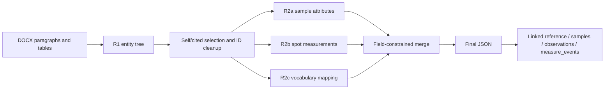

# Structured Extract


**Scientific document extraction through entity trees, staged slot filling and linked research tables.** This repository presents the main geochronology extraction workflow together with related stateful Agent, MCP, known-answer-control and seeded document-graph experiments. The original research implementations are retained, with their different contracts made explicit.

[English](README.md) · [简体中文](README.zh-CN.md)

## 🔬 Research focus

Scientific extraction requires preserving which sample, analytical spot, age, uncertainty and interpretation belong together. This project explores an explicit intermediate tree and separate extraction stages to organize those relationships, limit which fields a later model response can replace, and retain paper/sample links in downstream tables. Its research work includes task decomposition, prompt/schema design, deterministic merging, export semantics and observable checks for missing or misbound relations. [Research overview](docs/research_summary.zh-CN.md).

## 🌳 Main workflow



The main pipeline samples R1 at three temperatures and combines events for base-tree samples; R2a and R2c use sample batches while R2b reads the observation data. Numeric ages and error magnitudes from R1 are preserved when R2c adds descriptors. These are concrete implementation boundaries rather than a general correctness guarantee: event alignment is positional, and the main API requests JSON objects rather than enforcing the declared JSON schemas. [Methods and exact merge rules](docs/methods.md) · [Export contracts](docs/exports.md).

## 🕸️ Seed-Guided Document-Graph Recovery

An extraction result can also guide the search for missing information. Once a model has identified some samples and their age/error relationships, trusted relations can serve as hooks into the source document. The graph then uses nearby, similarly organized records to investigate missing bindings. The research idea is to **turn existing extraction relations into graph constraints and use document structure to propose additional relationships**.

The [core implementation](research/seeded_graph/seeded_document_forest.py) represents DOCX sentences, table cells, value/error pairs and sample entities as a weighted graph. Edges encode local text adjacency, table geometry and explicit entity mentions. For a known sample/value/error relation, Dijkstra selects the lowest-cost reachable source occurrence. A low-resistance seed channel anchors that relation for subsequent propagation.

Sample roots then act as fixed boundaries for a graph-Laplacian harmonic extension that minimizes Dirichlet energy. Together with translation of entity-to-value offsets in tables, this produces candidate bindings not present in the seed extraction. Least-cost paths ground known relations; minimum-energy propagation and structural templates extend the candidate search.


Consider a fictional table where samples A101 and A102 are known, but only A101 is bound to `120 ± 1`. That relation helps locate the sample, age and uncertainty positions. Applying the same structure to A102's row can propose `A102—130 ± 2`. This illustrates how an existing local result can guide relation recovery, rather than treating every value as an independent extraction target. The repository's [synthetic example](examples/graph_demo.py) checks this execution path.

Outputs retain candidate relations, graph potentials and energies, source evidence and template paths for review. This remains an independent recovery experiment; the controller does not automatically write candidates back into the main extraction state. See [Method and data contracts](docs/graph_recovery.md).

## 🧭 Versions and related experiments

| Component | Preserved entry | Role |
|---|---|---|
| Main staged pipeline | [pipeline.py](pipeline.py) | Entity tree, R2a/b/c, constrained merge and JSON/Excel output |
| Alternative staged v2 | [pipeline_v2.py](pipeline_v2.py) | Observation scaffold and independently extracted spots; different event/worksheet contract |
| Early incremental v3 | [versions/early_v3](versions/early_v3/README.md) | Isolated historical core with one implemented specialist and matching tests |
| Stateful controls / MCP | [geochron_agent_v3](geochron_agent_v3/controller.py) | Profile-local deltas, capabilities, known-answer controls, coverage audit and MCP facade |
| Seeded graph research | [research/seeded_graph](docs/graph_recovery.md) | Independent path probes and seed-grounded graph completion using earlier extraction results |

These components share one research repository. The Agent state does not yet feed the legacy exporter, and graph candidates are not automatically written back by its controller. [Version relationships and data contracts](docs/versions.md).

## ▶️ Run the offline examples

Python 3.11+ and `uv` are required. From this repository root:

```bash
uv sync --locked --all-extras
uv run --locked --all-extras python -B -m examples.staged_demo
uv run --locked --all-extras python -B -m unittest discover -s tests -v
uv run --locked --all-extras python -B -m examples.offline_demo
uv run --locked --all-extras python -B -m examples.graph_demo
uv run --locked --all-extras python -B -m scripts.mcp_smoke
uv run --locked --all-extras python -B -m scripts.check_repository
```

Dependency installation may use the package index. The listed demonstrations use fictional data and make no model calls. The staged demo executes the original orchestrator with fixture responses, then checks linked workbook contents for two papers sharing a sample ID. [Live configuration, export commands and early-version checks](docs/running.md).

## 📊 Execution evidence

The retained `doi_output/json` collection contains **310 final JSON artifacts**, with **1,752 sample records, 9,789 spot records and 6,140 event records**, including 46 empty final artifacts. Other collections are counted separately because they may overlap. These counts establish saved outputs; they are neither a unique-paper total nor measured extraction accuracy. [Per-artifact counts and hashes](evidence/historical_artifacts.jsonl) · [Evidence interpretation](docs/evidence.md).

Local validation checks field-preserving merges, adverse-response cases, output projection, cross-paper association, original Agent contracts, known-answer controls and an actual MCP stdio session. [Validation record](docs/validation.md).

## 🗂️ Repository map

```text
pipeline.py / run_layer*.py / prompts.py / vocab.py   Main staged implementation
pipeline_v2.py / prompts_v2.py                        Alternative staged contract
export_total.py / merge_tree_xlsx.py                  Original aggregation paths
geochron_agent_v3/                                   Coherent controls/MCP snapshot
research/seeded_graph/                               Independent graph experiments
versions/early_v3/                                  Isolated earlier core and tests
examples/ / tests/ / scripts/                       Offline demos and release tooling
docs/ / evidence/ / provenance/                     Method, evidence and source map
```

## 📚 Provenance and local review

The twelve main source modules and selected historical Agent/graph files are copied byte-for-byte. Added files provide presentation, packaging, fictional fixtures, local checks and guarded run/export wrappers. Component-specific Git history is unavailable for the untracked main source folder, so no commit-based personal-authorship claim is made. [Source manifest](provenance/source_manifest.json) · [Contribution and preservation boundaries](docs/provenance.md).

Real paper corpora, raw extraction outputs, credentials, model weights and private environments are excluded. The project distribution license and contributor attribution remain for owner confirmation in [LICENSE_PENDING.md](LICENSE_PENDING.md). This is a local review candidate; no repository or website has been published.
