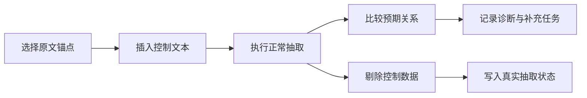
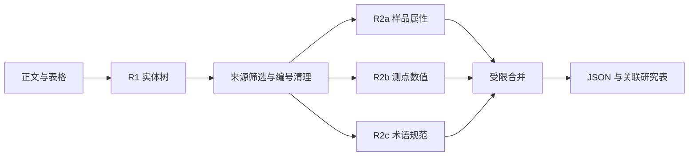

# FirstLight

**探索科学文献结构化抽取、已知答案校验与文档图关系恢复。**

[English](README.md) · [简体中文](README.zh-CN.md)

本项目面向地质年代学文献，从论文正文和表格中抽取样品、分析测点、年龄、误差及其相互关系，组织为可供后续科学分析使用的数据记录。

项目始于科研数据库建设中的模块化抽取流水线。随着批量处理的推进，研究关注点逐渐转向一个比 JSON 格式正确性更难判断的问题：**大语言模型可以生成结构完整、表面合理的结果，却遗漏原文中本应保留的信息。** 围绕这一问题，项目在分阶段抽取之外，进一步探索已知答案植入式控制和基于文档图的关系恢复。

**研究方法与代码直达：** [已知答案控制](geochron_agent_v3/honeypot.py) · [文档图恢复](research/seeded_graph/seeded_document_forest.py) · [分阶段抽取](pipeline.py) · [实验与验证](docs/validation.md)

## 1. 研究动机：结构正确不等于抽取完整

**外部研究提供了量化参照。** [Peng 等（2026）的 GeoExtractor 研究](https://doi.org/10.1038/s41598-026-74865-x)在 GEOROC 地球化学文献抽取基准上报告：其多智能体方法的**字段级召回率为 54.34%、F1 为 67.11%**；错误分析中，**遗漏占该数据集全部抽取错误的 90.6%**（论文 Table 2 与 Error Analysis）。这表明即使有专门设计的多阶段框架，也可能存在大量未被提取的字段。这里的数字属于 **GeoExtractor 的 GEOROC 评测**，不是 FirstLight 的错误率，也不能直接推广为年代学样品—年龄关系的遗漏率。

科学文献抽取不仅需要识别数值，还需要保留数值的归属和含义。一个年龄值必须对应到正确的样品、分析方法、误差及地质解释；同一样品的多个年龄结果，也不能未经判断就压缩成一个代表值。

早期研究说明中还记录了以下现象：

- **代表性压缩：** 同一样品具有多个年龄结果时，模型有时只保留部分具有代表性的记录。
- **结构性遗漏：** 对于重复组织的表格，模型有时遗漏一组结构相似的字段。
- **角色提示敏感性：** 小样本尝试中，地质学身份提示更容易出现代表性压缩；改用情报信息整理的角色描述，或用化学结构类比描述 JSON 实体树，部分情况下遗漏有所减少。

这些观察引出了一个待检验的假设：**结构化输出负担较高时，模型可能以符合领域语境的概括替代任务要求的穷举，产生无法通过格式检查发现的隐性缺失。** 早期方法和角色提示比较的代码、日志尚待补充归档，目前将其作为研究动机；现有材料不足以区分输出负担、提示词与模型先验各自的影响。

## 2. 已知答案控制：没有完整标准答案，如何发现遗漏？

缺乏完整人工标注时，很难直接判断哪些记录没有被提取。格式验证可以检查返回结果是否合法，却无法判断原文中是否还有未被发现的关系。项目因此实现了**已知答案植入式控制机制（Known-Answer Controls / Honeypot）**，为每次抽取提供局部可检验的参照。

### 2.1 方法与控制场景

系统将预先构造、答案已知的控制文本插入模型可见的文档内容，再按正常流程抽取并对照预期关系。原始论文文件不被修改，预期答案与注入位置记录保存在模型输入之外。



当前代码包含三类 U-Pb 控制模板，共五条预期关系：

| 控制场景 | 主要检测目标 |
|---|---|
| 同一样品具有两个独立年龄结果 | 是否选择性保留、合并或遗漏记录 |
| 不同样品出现在同一段落 | 是否将年龄绑定到错误样品 |
| 年龄与误差采用不同排版形式 | 是否因括号、空格等格式变化漏读 |

例如，同一样品的两个年龄结果如果只返回一条，即使 JSON 合法，仍会暴露控制关系的缺失。比较程序同时检查年龄—误差对、同位素体系、样品归属和本研究／引文来源，并记录遗漏、合并、错绑、误路由、来源混淆及解析噪声等诊断类别。

控制样品及其关联记录会在普通状态归约器接收增量之前剔除。结构化植入工具支持三类模板；当前控制器使用路由器选定的原文锚点，每个 profile 最多植入一项控制，锚点不满足检查时跳过。[蜜罐实现](geochron_agent_v3/honeypot.py) · [控制机制说明](docs/agent_controls.md)

### 2.2 可观测性与适用范围

这一机制无需整篇论文的完整标准答案，即可获得对抽取过程可靠性的局部观测，适合人工逐篇核查成本较高的批量任务。控制失败可以提示需要进一步检查的位置或关系类型，并为补充抽取提供上下文。

控制通过只能说明模型完成了相应控制任务。它与真实记录遗漏之间的相关性、异常检测的灵敏度和特异度仍需校准，不能直接换算为整篇文献的召回率。

## 3. 文档图恢复：从已有关系寻找遗漏候选

另一项探索利用文档自身的结构：**正文和表格可以统一表示为带权文档图，而表格额外提供行、列、单元格和重复记录模式。** 已经确认的局部关系可以为这些结构提供约束，帮助寻找尚未绑定的数据。

### 3.1 统一的文档图表示

当前实现直接解析 DOCX XML，将正文和表格组织为以下图元素：

| 图元素 | 文档中的对应对象或关系 |
|---|---|
| 文本节点 | 正文句子 |
| 单元格与行节点 | 表格位置和行结构 |
| 实体根节点 | 前期已识别的样品 |
| 数值节点 | 显式数值—误差对，以及相邻纯数值单元格形成的候选对 |
| 带权边 | 文本邻接、行列关系、实体提及与数值归属 |

边的代价区分不同类型的结构连接。样品与其显式提及位置直接相连，跨句、跨段或跨单元格关系则经由相应结构边传播；编号标题还构成局部边界。权重与阈值是当前实验中的启发式设定。

### 3.2 从已知关系恢复候选关系

以下虚构表格对应仓库中的合成示例：

| 样品 | 年龄（Ma） | 误差 |
|---|---:|---:|
| A101 | 120 | 1 |
| A102 | 130 | 2 |
| A103 | 140 | 3 |

假设前期结果已识别三个样品，但只提取了 `A101 → 120 ± 1`，其余两个样品尚未绑定年龄。这条可信关系可以作为结构种子，组合三种方法寻找遗漏候选：

1. **最低代价定位。** Dijkstra 搜索样品根节点到相同数值—误差对的可达位置，选择代价最低的原文出现位置，并建立低阻力的种子绑定通道。
2. **结构模板迁移。** 从种子关系记录样品与年龄、误差单元格的相对行列偏移，在同一表格中检查其他已知样品的对应位置。
3. **最小能量传播。** 以样品根节点作为固定边界，通过图拉普拉斯的调和延拓求解最小 Dirichlet 能量分布，评估数值候选与各样品的关联。


算法返回候选关系集合，并保留来源、模板路径、图上势值及由势值计算的能量分数。Dijkstra 负责种子定位，图拉普拉斯和结构模板负责后续扩展；输出仍可包含竞争候选，需要进一步核查。

### 3.3 设计动机与当前结果

对于具有重复模式的表格，局部可靠关系已经提供了一部分明确的结构信息。将这些信息编码为图，可以用已有结果引导后续搜索，减少重复生成整篇文献抽取结果的需要。

仓库合成示例调用原始图实现，已检查能够由 `A101 → 120 ± 1` 种子提出 `A102 → 130 ± 2` 和 `A103 → 140 ± 3` 两条目标候选。另有历史真实文献候选产出摘要，但尚无完整人工标注来衡量恢复准确率和新增召回。

该模块目前独立运行，读取旧版抽取结果作为种子，尚未接入控制器自动写回。它依赖可信种子、文档解析和重复结构；错误种子及 OCR 噪声对传播结果的影响仍需评估。[文档图实现](research/seeded_graph/seeded_document_forest.py) · [方法与数据契约](docs/graph_recovery.md) · [合成示例](examples/graph_demo.py)

## 4. 工程基础：分阶段抽取与状态式 Agent

### 4.1 分阶段抽取流水线

主流程先建立实体关系，再由不同阶段补全属性和数值，最后按字段权限合并。各阶段共享论文文本，并接收与自身任务相关的实体树。

| 阶段 | 主要任务 | 合并规则 |
|---|---|---|
| R1 | 识别论文、样品、测点和年龄事件，建立实体树 | 在三个温度下采样，为基准树中的样品汇集年龄事件 |
| R2a | 补充岩性、地层和地理位置等样品属性 | 仅更新指定样品属性与 `location` |
| R2b | 读取测点的同位素比值、年龄和不确定度 | 仅保留允许的测点字段 |
| R2c | 规范分析技术、同位素体系、物理方法和统计描述 | 补充描述字段，保留 R1 的年龄数值和误差大小 |
| Merge / Export | 合并结果并导出研究数据 | 输出嵌套 JSON、单篇审核表及跨论文关联表 |



分阶段处理既降低单次输出的复杂度，也明确不同步骤的数据责任。例如，术语规范化不能顺带改写已经抽出的年龄值。跨论文导出以 `paper_id` 和 `sample_id` 维持 `reference`、`samples`、`observations`、`measure_events` 之间的关联，为后续查询和科学分析提供数据接口。

当前实现也存在具体约束：R2c 按列表位置对齐事件；R2b 返回列表中的漏项仍可能传入最终结果；主 API 使用 JSON object 模式，声明的 Schema 尚未接入严格服务端校验。这些问题与字段保护的作用需要分别评估。[主流程代码](pipeline.py) · [抽取方法与合并规则](docs/methods.md) · [数据导出](docs/exports.md)

**早期技术探索。** 早期探索涉及三元组构造、BERT-NER、GLiNER、词频分析和基于掩码语言模型的评分。对于年代学编号识别，地名、普通实体和解析异常字符容易混入候选，后续因而转向生成式 LLM，并通过分阶段处理组织复杂输出。

### 4.2 状态式 Agent 与 MCP 接口

工程实现采用 Python 控制器、OpenAI 兼容模型客户端和官方 MCP Python SDK。控制器根据文档选择专业 profile，专业调用读取全文并返回局部增量；状态归约器检查字段、方法和节点写入权限，保留冲突、未覆盖项及模型调用记录。

已知答案控制已接入这条执行路径：首次抽取的写入被拒绝或控制检查失败时，控制器可安排 `enrich_candidates` 补充任务，并在预算内继续覆盖审计。MCP 层暴露 profile 查询、增量验证、任务规划、抽取、控制文本准备／植入／评估和覆盖审计工具；本地控制器仍直接调用 Python 函数。

注册表包含 17 张专业字段卡，字段卡的存在与对应方法完成真实文献评测是两回事。当前工程证据包括离线契约检查和 MCP stdio 会话；各专业方法的抽取质量仍需分别评估。[控制器](geochron_agent_v3/controller.py) · [状态归约器](geochron_agent_v3/state.py) · [MCP 接口](geochron_agent_v3/mcp_server.py)

## 5. 模块化研究与技术演化

项目随实际抽取任务暴露的问题逐步演化，形成了职责不同的模块：

| 研究方向 | 主要问题 | 实现方式 |
|---|---|---|
| 分阶段抽取 | 如何组织复杂关系并分配输出责任 | 实体树、分阶段填充、受限合并、关联导出 |
| 状态式抽取 Agent | 如何控制专业任务与状态写入 | Profile 路由、局部增量、写入权限、覆盖审计、MCP |
| 已知答案控制 | 如何观察隐性遗漏和错绑 | 控制文本植入、预期关系比较、异常诊断与补充任务 |
| 文档图恢复 | 如何利用已有结果寻找缺失关系 | Dijkstra 定位、结构模板、图拉普拉斯传播 |
| 小模型适配（相关独立项目） | 如何通过领域训练改善抽取能力 | 生成式模型、LoRA、CPT／SFT 与抽取策略实验 |

这些方向共享科学文献抽取背景，但使用不同的数据契约。主分阶段流程、`pipeline_v2.py`、早期增量 v3 和当前控制／MCP 快照在仓库中分别保留；Agent 状态尚未接通旧版导出器，图候选也尚未自动写回。小模型训练与实验保留在[独立仓库](https://github.com/dvdsvc/sigil)。[版本关系](docs/versions.md) · [来源与保留边界](docs/provenance.md)

## 6. 实验现状与下一步

项目已实现并运行批量抽取流程，保留了历史输出、结构化导出、模块测试和离线验证示例。历史 `doi_output/json` 集合中有 **310 份最终 JSON**，包含 **1,752 条样品、9,789 条测点和 6,140 条事件记录**，其中 46 份最终文件样品为空。其他运行目录分别统计，避免将重复运行计为独立论文。这些数字反映数据产出规模，尚不能作为抽取质量指标。[历史证据](docs/evidence.md) · [检查记录](docs/validation.md)

初期开发主要服务于实际科研任务，没有同步建立充分的人工标注集，也未形成基于现有年代学数据库的统一端到端基准。因此，早期方法选择更多依赖有限样本的定性比较，目前仍需量化以下问题：

- 角色提示和结构化输出负担如何影响遗漏率。
- 已知答案控制能否有效识别真实记录的遗漏与错绑。
- 文档图恢复能增加多少正确关系，又会引入多少错误绑定。

后续拟人工校核已有抽取结果，并结合 USGS Geochron 等数据库构建评测数据，分别评估记录完整性、样品—年龄—误差绑定、来源一致性和新增候选质量，再检验各模块的实际收益。

## 7. 代码与运行

### 7.1 主要入口

| 入口 | 内容 |
|---|---|
| [pipeline.py](pipeline.py) · [prompts.py](prompts.py) | 主抽取调度、分阶段提示词与合并 |
| [export_total.py](export_total.py) | 跨论文关联导出 |
| [geochron_agent_v3/](geochron_agent_v3/controller.py) | 状态式 Agent、已知答案控制与 MCP |
| [research/seeded_graph/](research/seeded_graph/seeded_document_forest.py) | 独立文档图恢复实验 |
| [examples/](examples/staged_demo.py) · [tests/](tests/test_staged_contracts.py) | 合成示例与契约检查 |
| [docs/](docs/running.md) · [evidence/](evidence/historical_summary.json) · [provenance/](provenance/source_manifest.json) | 方法、运行说明、证据与来源映射 |

### 7.2 离线示例

使用 Python 3.11+ 和 `uv`，在仓库根目录执行：

```bash
uv sync --locked --all-extras

uv run --locked --all-extras python -B -m examples.staged_demo
uv run --locked --all-extras python -B -m examples.offline_demo
uv run --locked --all-extras python -B -m examples.graph_demo
```

依赖安装可能访问软件包索引。示例使用合成数据或预设模型响应，不调用在线模型；分别演示分阶段调度与关联导出、控制关系比较、种子驱动图候选生成。运行检查：

```bash
uv run --locked --all-extras python -B -m unittest discover -s tests -v
uv run --locked --all-extras python -B -m scripts.mcp_smoke
uv run --locked --all-extras python -B -m scripts.check_repository
```

### 7.3 实际文献抽取

复制 `.env.example` 为本地 `.env`，填写 `DEEPSEEK_API_KEY`、`DEEPSEEK_BASE_URL` 和 `DEEPSEEK_MODEL`，再运行带输出覆盖检查的入口：

```bash
uv run --locked python -B -m scripts.run_staged local_runs/paper-A/full.docx
```

该命令会调用所配置的模型服务，元数据补全还可能请求 OpenAlex。请为每篇论文使用不同父目录名。Agent／MCP 配置、关联导出及其他版本的命令见[运行说明](docs/running.md)；凭证配置见[环境变量](docs/security.md)。

### 7.4 代码来源

仓库保留原始主流程、选定的 Agent／MCP 和图研究代码；展示文档、依赖配置、合成示例及检查工具在整理时补充。逐文件来源和哈希见[来源清单](provenance/source_manifest.json)。论文全文、原始抽取文本、凭证和模型权重未随展示代码分发；贡献者署名与分发许可见 [LICENSE_PENDING.md](LICENSE_PENDING.md)。
