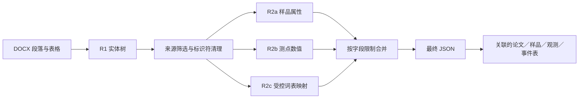
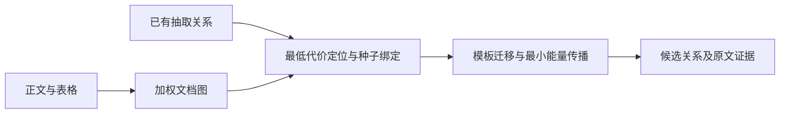

# Structured Extract


**以实体树、分阶段槽位抽取和关联研究表为核心的科学文献信息处理项目。** 这个仓库以地质年代学主抽取流程为入口，同时收录增量 Agent、MCP、已知答案控制和种子驱动文档图恢复实验，保留原始研究实现并明确各自的数据契约。

[English](README.md) · [简体中文](README.zh-CN.md)

## 🔬 研究问题

科学文献抽取需要保持样品、分析测点、年龄、误差与解释之间的归属关系。本项目通过显式实体树和阶段分工组织这些关系，限制后续模型响应可改写的字段，并将论文／样品关联传递到分析表。值得展示的研究工作包括任务拆解、提示词与结构设计、确定性合并、导出语义，以及遗漏和错绑关系的可观测校验。[研究介绍](docs/research_summary.zh-CN.md)。

## 🌳 主抽取流程



主流程以三个温度运行 R1，对基准树已有样品合并事件；R2a、R2c 按样品分批处理，R2b 读取观测数值。R2c 添加描述字段时，程序保留 R1 的年龄数值与误差大小。这些是具体的实现约束：事件仍按位置对齐，主 API 使用 JSON object 模式，并未把代码中声明的 JSON Schema 接入严格服务端校验。[方法与实际合并规则](docs/methods.md) · [导出契约](docs/exports.md)。

## 🕸️ 种子驱动的文档图恢复

前一次抽取的结果，也可以成为下一轮寻找遗漏信息的线索。假如模型已经识别了若干样品及其年龄、误差关系，就可以选择其中可信的关系作为 hook，回到原文定位，再沿文档结构调查与它们相邻、具有相同组织方式的记录。这里探索的是：**将已有抽取关系转化为图上的约束，用结构补全寻找尚未绑定的关系。**

[核心实现](research/seeded_graph/seeded_document_forest.py)将 DOCX 中的正文句子、表格单元格、数值与误差，以及样品实体组织为带权图。连边表示局部文本邻接、表格位置关系和实体提及。对于一条已知的“样品—数值—误差”关系，程序使用 Dijkstra 选择可达的最低代价原文位置，再建立低阻力的种子绑定通道，使这条已知关系成为后续传播的约束。

接下来，程序以样品根节点为固定边界，通过图拉普拉斯的调和延拓进行最小能量传播，并结合表格中实体与数值位置的模板迁移，提出尚未抽出的绑定候选。因此，最低代价路径负责把种子落回原文，最小能量传播与结构模板则负责扩展候选范围。



以一个虚构表格为例：系统已识别样品 A101 和 A102，但只为 A101 绑定了 `120 ± 1`。这条关系可以帮助定位表格中的样品、年龄与误差位置，再将同一结构用于检查 A102 所在行，提出 `A102—130 ± 2` 候选。这个例子体现了原有局部结果如何帮助恢复关联，而不是把每个值视为彼此独立的抽取目标；仓库的[合成示例](examples/graph_demo.py)检查了这一执行路径。

输出保留候选关系、图上势值与能量、来源及模板路径，供后续核查。目前它作为独立恢复实验运行，尚未由 controller 自动写回主抽取状态。[完整方法与数据契约](docs/graph_recovery.md)。

## 🧭 版本与相关实验

| 组成 | 保留入口 | 定位 |
|---|---|---|
| 主分阶段流程 | [pipeline.py](pipeline.py) | 实体树、R2a/b/c、受限合并及 JSON／Excel 输出 |
| 分阶段 v2 尝试 | [pipeline_v2.py](pipeline_v2.py) | observations 脚手架、独立 spot 抽取；事件结构和表名不同 |
| 早期增量 v3 | [versions/early_v3](versions/early_v3/README.md) | 独立存档，保留当时唯一已实现的专业工具及配套测试 |
| 状态式控制／MCP | [geochron_agent_v3](geochron_agent_v3/controller.py) | profile 局部增量、写入权限、已知答案控制、覆盖审计与 MCP 外壳 |
| 种子文档图研究 | [research/seeded_graph](docs/graph_recovery.md) | 以前期抽取关系为锚点的路径探查与图补全实验 |

这些内容统一在一个科研展示仓库中。增量 Agent 的状态尚未接通旧版导出器；图候选也不会由 controller 自动写回。[版本关系与数据契约](docs/versions.md)。

## ▶️ 运行离线示例

需要 Python 3.11+ 和 `uv`，在本仓库根目录执行：

```bash
uv sync --locked --all-extras
uv run --locked --all-extras python -B -m examples.staged_demo
uv run --locked --all-extras python -B -m unittest discover -s tests -v
uv run --locked --all-extras python -B -m examples.offline_demo
uv run --locked --all-extras python -B -m examples.graph_demo
uv run --locked --all-extras python -B -m scripts.mcp_smoke
uv run --locked --all-extras python -B -m scripts.check_repository
```

安装依赖可能访问软件包索引；上述示例使用虚构数据，不调用模型。主流程示例以预设响应执行原始调度器，再检查两篇论文中同名样品在关联工作簿里的归属。[模型配置、导出及历史版本运行说明](docs/running.md)。

## 📊 执行证据

历史 `doi_output/json` 集合中保留 **310 份最终 JSON**，包含 **1,752 条样品、9,789 条测点、6,140 条事件记录**，其中 46 份最终文件样品为空。其他目录单独统计，避免把重复运行算成不同论文。这些数字证明存在实际产出，不能作为独立论文总数或抽取准确率。[逐文件计数与哈希](evidence/historical_artifacts.jsonl) · [证据解释](docs/evidence.md)。

本地验证覆盖保留数值的合并、异常响应边界、出口投影、跨论文关联、原始 Agent 契约、已知答案控制及实际 MCP stdio 会话。[检查记录](docs/validation.md)。

## 🗂️ 仓库结构

```text
pipeline.py / run_layer*.py / prompts.py / vocab.py   主分阶段研究实现
pipeline_v2.py / prompts_v2.py                        另一套分阶段契约
export_total.py / merge_tree_xlsx.py                  原始汇总导出路径
geochron_agent_v3/                                   配套一致的控制／MCP 快照
research/seeded_graph/                               独立文档图实验
versions/early_v3/                                  早期核心和测试，隔离保存
examples/ / tests/ / scripts/                       离线示例与整理辅助工具
docs/ / evidence/ / provenance/                     方法、证据和来源映射
```

## 📚 来源与本地审阅

十二个主流程模块和选中的历史 Agent／图代码逐字节保留；新增内容包括展示文档、依赖配置、虚构示例、本地检查和带覆盖检查的运行／导出辅助入口。主流程原目录是大工作区中的未追踪子目录，没有可归属到该组件的提交历史，因此不会据此推定个人独立创作比例。[来源清单](provenance/source_manifest.json) · [贡献及保留边界](docs/provenance.md)。

实际论文语料、原始抽取文本、密钥、模型权重和私人环境未打包。项目许可证与贡献者署名仍需作者在 [LICENSE_PENDING.md](LICENSE_PENDING.md) 中确认。当前为本地审阅候选，尚未公开仓库或部署网站。
